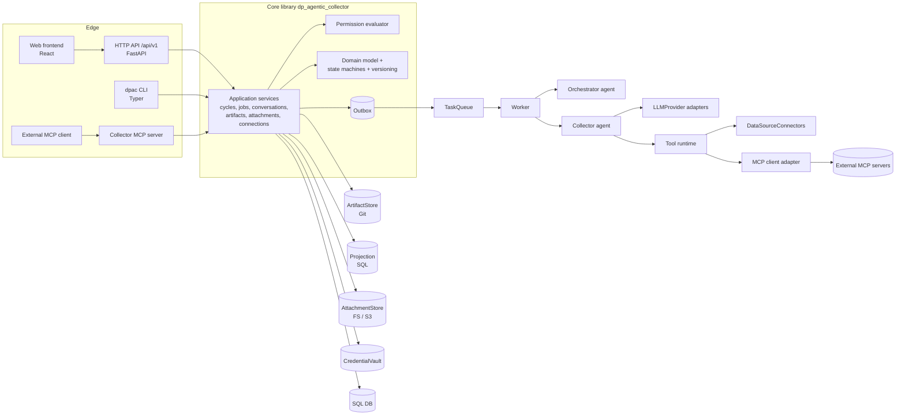
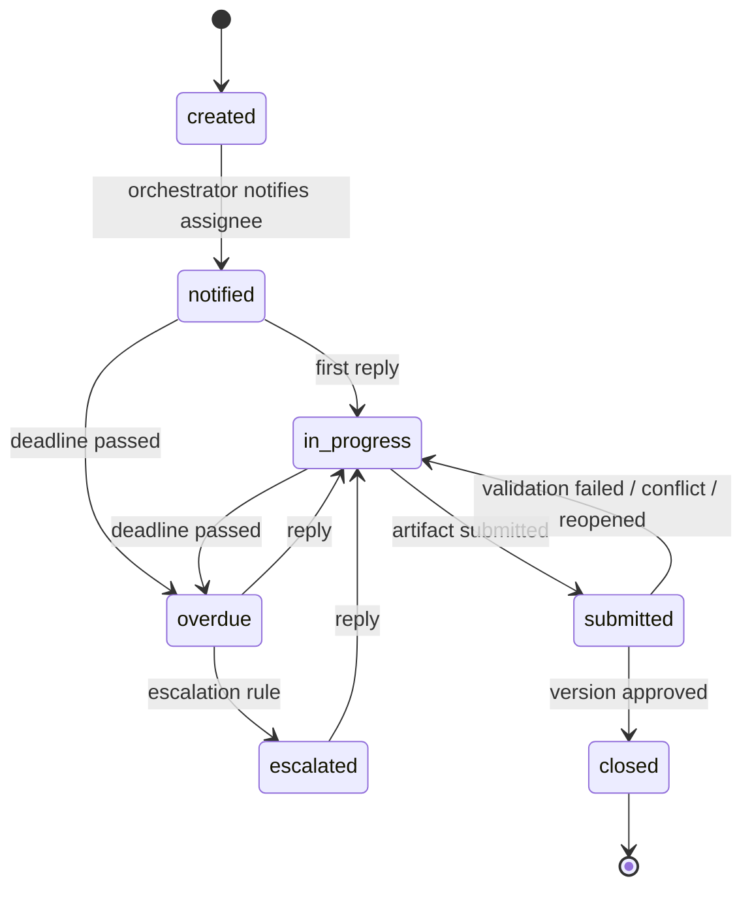
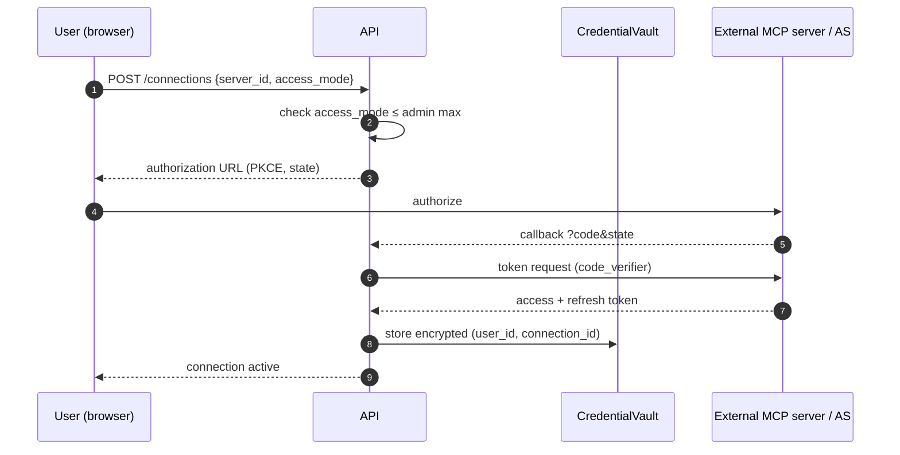
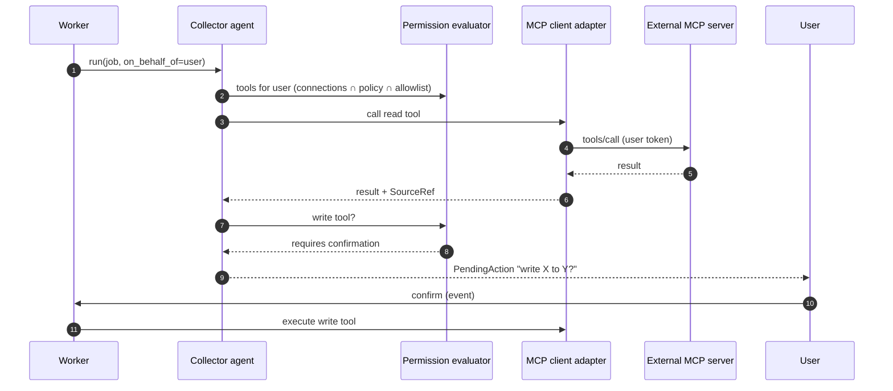

# Architecture — DP Agentic Collector

Status: living document. The binding goals are in [MISSION.md](MISSION.md); decisions and
assumptions are recorded as ADRs in [decisions/](decisions/).

## 1. Glossary

Names in this table are used identically in code, docs, API and tests.

| Term | Code name | Meaning |
|---|---|---|
| **Tenant** | `Tenant`, `tenant_id` | Isolation boundary. Every entity, query, store, permission and connection is scoped by `tenant_id`. |
| **User** | `User`, `user_id` | An authenticated person within a tenant. Has locale, roles, active flag and external identities (for OIDC/SSO). |
| **Role** | `Role` | RBAC role: `admin`, `cycle_owner`, `respondent`, `viewer`. Combined with subject-level grants (`SubjectGrant`). |
| **Cycle** | `Cycle`, `cycle_id` | A named collection round (e.g. `app-inventory-2026-Q4`) with scope, owner, participants, deadlines; one-off or recurring. Used *only* for this domain concept. |
| **Subject** | `Subject`, `subject_id` | The thing information is collected about (e.g. one application). Cycle-scoped; `lineage_key` links the same real-world thing across Cycles (ADR-0003). |
| **SubjectType** | `SubjectType` | Plugin describing a kind of Subject: JSON Schema, factsheet template, ValidationRules, conversation guide. |
| **CollectionJob** | `CollectionJob`, `job_id` | Assignment of one Subject to one assignee within a Cycle; a Subject can have several jobs (ADR-0017). Has a persisted **state machine** and its own `base_version`. |
| **Conversation** | `Conversation` | The persisted, resumable exchange belonging to a CollectionJob. |
| **Participant** | `Participant` | A member of a Conversation: a user (`kind=user`) or an agent (`kind=agent`). |
| **Message** | `Message` | One entry in a Conversation (text, fact proposal, confirmation request, system notice). |
| **Agent run** | `AgentRun`, `agent_run_id` | One execution of an agent (orchestrator or collector) on behalf of a user, triggered by an event. Recorded as contributor in artifacts. |
| **AgentDefinition** | `AgentDefinition` | Declarative YAML description of an agent: role, prompt, provider/model, allowed tools, SubjectTypes, escalation. |
| **Artifact version** | `ArtifactVersion` | An immutable pair *factsheet (Markdown) + data file (JSON)* sharing one `ArtifactHeader`. |
| **Snapshot** | `Snapshot` | A named, frozen view of all latest artifact versions of a Cycle at a point in time. |
| **Fact proposal** | `FactProposal` | A value for a data-file field proposed by an agent and confirmed/rejected by the user. |
| **Attachment** | `Attachment`, `attachment_id` | An immutable uploaded file (content-addressed) with **visibility** `private` or `shared` and status `active`/`withdrawn`/`deleted`. |
| **MCP server definition** | `McpServerDefinition` | Admin-managed registration of an external MCP server: transport, endpoint, auth type, max access mode, tool classification. |
| **User connection** | `UserConnection` | A user's own connection to an MCP server definition, with granted access mode and a credential reference. |
| **Access mode** | `AccessMode` | `read` or `read_write`. Effective mode = min(admin maximum, user grant). |
| **Write confirmation** | `PendingAction` | A write tool call that waits for explicit user confirmation. |
| **Auth session** | `AuthSession` | A login session (cookie) of a user. Never called "session" alone. |
| **Provenance / sources** | `SourceRef` | Where an externally obtained fact came from (MCP tool or attachment), when, on whose behalf. |
| **Consolidation report** | `ConsolidationService.report` | Gaps and contradictions across the subjects of one Cycle (ADR-0021). |
| **Actor context** | `ActorContext` | Who acts: tenant, user, roles, optional agent run, trace id. Passed to every service call. |

Wording rules: "state machine" (never "lifecycle") for job and artifact states; "auth session"
for login sessions; "Cycle" only for collection rounds.

## 2. Architectural guardrails

1. **Domain over technology** — `dp_agentic_collector.domain` is pure Python (stdlib
   `dataclasses`, `enum`). It imports no SQLAlchemy, pygit2, FastAPI, Pydantic, LLM or MCP SDK
   types. A test (`tests/test_architecture.py`) enforces this import rule.
2. **Multi-tenant ready** — every entity has `tenant_id`; repositories are constructed for one
   tenant and add the filter to every query; stores are partitioned by tenant (one Git
   repository and one attachment prefix per tenant).
3. **Asynchronous by design** — HTTP handlers only write state + outbox events. Workers consume
   events through the `TaskQueue` interface and run agents. No LLM/MCP call inside a request.
4. **Isolation of extensions** — connectors and tools preferably as MCP servers
   (out-of-process). In-process plugins only for trusted SubjectTypes, ValidationRules,
   FileProcessors and adapters.
5. **Open-ended models** — conversations have participant lists; users have external
   identities; locale on users, templates, factsheets (de/fr/it/en).
6. **Versioned contracts** — `/api/v1`, `schema_version` in data files, `api_version` in
   AgentDefinitions, `INTERFACE_VERSION` on every extension-point interface.
7. **Privacy by design** — artifacts reference `user_id` only; see §10 erasure strategy.
8. **Observable** — `trace_id` (OpenTelemetry) is created at the API edge, stored on outbox
   events, restored in the worker, propagated to agent runs and tool/MCP calls; JSON logs.
9. **Provider-neutral AI** — internal `LlmMessage`/`ToolCall` format; providers and MCP SDK
   are adapters.

## 3. Build vs. use

| Concern | Build | Use (inside adapters only) |
|---|---|---|
| Domain model, state machines, versioning semantics | ✔ | — |
| Orchestrator, collector behaviour, consolidation | ✔ | — |
| Permission evaluation | ✔ (intersection logic) | — |
| Plugin system, registries, outbox | ✔ | `importlib.metadata` entry points |
| LLM access | adapter layer | `anthropic`, `openai` SDKs |
| MCP | adapter layer | official `mcp` Python SDK |
| Auth | flows, policies | Authlib (OAuth/OIDC client), argon2-cffi, cryptography (Fernet) |
| Persistence | repositories | SQLAlchemy 2, Alembic, pygit2 |
| Validation / templating / diff | rules | jsonschema, Jinja2, deepdiff, difflib |
| File processing | registry | pypdf, python-docx, openpyxl, python-magic |
| API / CLI | thin layers | FastAPI, Typer |
| Frontend | chat UI | React, Vite, TanStack Query, shadcn/ui (Tailwind + Radix), react-i18next, Monaco |
| Observability | context propagation | OpenTelemetry SDK + OTLP exporter |

Interface-first, swappable later: `TaskQueue` (in-process → Temporal/Celery),
`CredentialVault` (DB/Fernet → HashiCorp Vault/Key Vault/Secrets Manager),
`IdentityProvider` (local → any OIDC IdP), `AttachmentStore` (filesystem → S3-compatible).
Each dependency has an ADR (why, alternatives, exit path).

## 4. Components



Package layout (`backend/src/dp_agentic_collector/`):

| Package | Responsibility |
|---|---|
| `domain/` | Entities, enums, state machines, artifact header/version/diff semantics, permissions model, errors. Pure Python. |
| `extensions/` | The 13 extension-point interfaces (ABCs with `INTERFACE_VERSION`), `Registry`, plugin loader. |
| `adapters/` | Implementations that use third-party libraries: SQL repositories, Git ArtifactStore, SQL projection, Fernet vault, FS attachment store, file processors, LLM providers, MCP client/server, local identity provider, in-process queue. |
| `services/` | Application services orchestrating domain + ports; every method takes an `ActorContext`. |
| `agents/` | Orchestrator, collector agent loop, tool runtime, AgentDefinition loading. |
| `api/` | FastAPI app, routers, request/response schemas (Pydantic), auth session middleware, CSRF. |
| `cli.py` | `dpac` Typer CLI (also the CLI channel). |
| `plugins/` (repo root `backend/plugins/`) | Local plugin folders, e.g. `subject_types/application`. |

## 5. Extension points

Every extension point is an abstract base class in `extensions/` with a class attribute
`INTERFACE_VERSION`, a `Registry` instance and at least one example implementation.
Plugins register through the entry-point group `dp_agentic_collector.plugins` or by placing a
folder with `plugin.py` (exposing `register(registries)`) or a declarative `subject_type.yaml`
in a plugins directory (`DP_AC_PLUGINS_DIR`).

| # | Extension point | Interface | MVP implementation(s) |
|---|---|---|---|
| 1 | SubjectType | `SubjectType` | Folder package loader (`subject_type.yaml` + schema + templates + rules + guide); example `application` |
| 2 | ChannelAdapter | `ChannelAdapter` | `web` (messages via API), `cli` |
| 3 | DataSourceConnector | `DataSourceConnector` | `file` (JSON/YAML prefill files), `previous_versions` (ArtifactStore), `mcp` (generic, per user connection) |
| 4 | ArtifactStore | `ArtifactStore` | `GitArtifactStore` (pygit2) |
| 5 | Projection | `Projection` | `SqlProjection` |
| 6 | ValidationRule | `ValidationRule` | Rules shipped with SubjectTypes |
| 7 | LLMProvider | `LlmProvider` | `anthropic`, `openai_compatible`, `fake` |
| 8 | AgentDefinition | `AgentDefinition` (YAML, `api_version: dpac/v1`) | `orchestrator.yaml`, `collector.yaml` |
| 9 | IdentityProvider | `IdentityProvider` | `local` (argon2 passwords); OIDC adapter skeleton via Authlib |
| 10 | CredentialVault | `CredentialVault` | `DbCredentialVault` (Fernet-encrypted rows) |
| 11 | AttachmentStore | `AttachmentStore` | `FilesystemAttachmentStore` (content-addressed, sha256) |
| 12 | FileProcessor | `FileProcessor` | PDF, DOCX, XLSX, CSV, Markdown/plain text, images (pass-through) |
| 13 | TaskQueue | `TaskQueue` | `InProcessTaskQueue` polling the DB outbox |

## 6. Domain state machines

### CollectionJob



### Artifact status (per version header)

`draft → submitted → validated → approved`. Each transition creates a **new immutable
version** with identical content (`content_hash` unchanged) and a new header (ADR-0004).

## 7. Versioning

* An `ArtifactVersion` = factsheet + data file, written atomically (one Git commit).
* Shared header (identical in both files): `tenant_id, subject_id, cycle, version, based_on,
  schema_version, locale, status, contributor{user_id, agent_run_id}, created, content_hash,
  change_reason, sources[]`.
  * Data file: JSON object `{"header": {...}, "data": {...}}`.
  * Factsheet: YAML front matter with the header, followed by Markdown.
* `content_hash` = sha256 over canonical JSON of `data` + the factsheet body (header excluded),
  enabling integrity checks and "content unchanged" detection.
* `put(new, expected_based_on)` fails with `VersionConflict` if the latest version is not
  `expected_based_on` — never silent overwrite. The collector then shows the field diff and lets
  the user choose per field (`ConflictResolution`), producing a new version based on latest.
* Structured facts only in the data file; factsheet tables are rendered from it via the
  SubjectType template, plus context, rationale, sources, open points and an auto-generated
  "changes since previous version" section.
* Snapshots: `snapshot(cycle, name)` freezes the latest version of each subject in the Cycle.
  Diff against any snapshot, including one of the previous Cycle (via `lineage_key`).
* Validation: stage 1 JSON Schema, stage 2 ValidationRules → `validated`; cycle owner approval
  → `approved`.
* `schema_version` + `SchemaMigration`s (registered per SubjectType) upgrade old data on read.
* ArtifactStore API: `put`, `get(subject, version|latest|snapshot)`, `history`, `diff`
  (field-level via deepdiff + text diff via difflib), `as_of(cycle, timestamp)`,
  `verify` (content_hash), `snapshot`, `list_snapshots`.
* Git layout (implementation detail): one repository per tenant;
  `subjects/<subject_id>/data.json` + `factsheet.md`; one commit per version;
  ref `refs/dpac/versions/<subject_id>/<n>` per version; snapshot tags
  `refs/tags/snapshots/<cycle_id>/<name>`. Swappable for a DB-backed store.
* `SqlProjection` stores every version (history queries), with a `is_latest` flag.

## 8. Authentication, authorization and delegated access

Every action runs in an `ActorContext(tenant_id, user_id, roles, agent_run_id?, trace_id)`.
Agents never have own privileges: an agent run carries the context of the user it acts for.

Effective permission for an action on a resource:

```
allowed = rbac_or_subject_grant(user, action, subject)
        ∧ admin_policy(tenant, action/tool)
        ∧ user_grant(connection.access_mode, tool.classification)   # MCP only
        ∧ agent_allowlist(agent_definition.allowed_tools)            # agent only
        ∧ attachment_visibility(attachment, user)                    # attachments only
```

Implemented in `domain/permissions.py` (pure) and applied in services; denied decisions are
audited.

RBAC matrix (subject-level grants add `read`/`contribute` on single subjects):

| Action | admin | cycle_owner | respondent | viewer |
|---|---|---|---|---|
| manage tenant, users, MCP servers, LLM config | ✔ | | | |
| create/manage Cycles, jobs, approve, snapshot | ✔ | own Cycles | | |
| read subjects/artifacts | ✔ | own Cycles | assigned / granted | granted / all in tenant (read) |
| converse, upload, submit | | | assigned jobs | |

Auth sessions: cookie with random id, server-side `AuthSession` rows (hashed id), CSRF double
submit token, login rate limiting. API clients may use bearer tokens (OAuth 2.1 access tokens
issued by the Collector, scopes `dpac.read`, `dpac.write`).



## 9. Decentralized knowledge via MCP

**Client.** Admins register `McpServerDefinition`s (stdio or streamable HTTP; auth none, OAuth
2.1 or API key; max access mode; tool classification overrides). Users create
`UserConnection`s; tokens live in the `CredentialVault` and are refreshed before use; revoked
or expired connections make the tools disappear from the agent's tool list and produce a
graceful notice. Tool classification: MCP `readOnlyHint=true` → `read`; otherwise `write`;
admin overrides win; unknown = `write`. Write tools are only offered on `read_write`
connections and every call becomes a `PendingAction` that the user must confirm (showing
server, tool and arguments). Results used in the data file are stored as `SourceRef`s.
Nothing is bulk-copied or indexed.



**Server.** `dpac` exposes an MCP server (streamable HTTP, mounted at `/mcp`) with tools for
cycles, jobs, subjects, factsheets, data files, attachments (shared + caller's private),
history, diffs and snapshots; with `dpac.write` scope it can start Cycles and submit data.
Bearer tokens are issued by the Collector's OAuth 2.1 endpoints (authorization code + PKCE)
and map to the same `ActorContext` and permission filtering as the API.

## 10. Attachments and privacy

* Upload (multi-file) in the conversation → `Attachment` linked to conversation, job, subject;
  binary in `AttachmentStore` (content-addressed); text extracted by a `FileProcessor`.
* Visibility `private` (default; uploader + agents acting for them) or `shared` (everyone with
  read access on the subject). Uploader can switch private → shared, withdraw shared ones,
  delete own private ones (content erased, metadata kept, audited).
* Facts extracted from a private attachment require a visibility confirmation before they
  enter the data file; the `SourceRef` stores attachment id + hash, not the file.
* Limits: max size, MIME allowlist (sniffed with python-magic), filename sanitization,
  `Content-Disposition: attachment` + `X-Content-Type-Options: nosniff`, malware-scan hook.

**Erasure strategy (Swiss FADP/DSG)** — see ADR-0011: artifacts only contain `user_id`s;
erasing a user pseudonymizes the user row (name/email/external ids removed) and deletes their
credentials, auth sessions and private attachments' content. Personal data accidentally written
into factsheet text is handled by a *redaction version* plus, if legally required, a documented
history rewrite of the tenant repository (operator procedure; `dpac admin erase-text` tooling is planned for phase 2), which is an explicit,
audited operator action.

## 11. Agents and asynchronous flow

```mermaid
sequenceDiagram
  autonumber
  participant O as Cycle owner
  participant API
  participant OB as Outbox
  participant W as Worker
  participant OR as Orchestrator
  participant C as Collector agent
  participant R as Respondent
  O->>API: POST /cycles/{id}/start
  API->>OB: cycle.started
  W->>OR: handle(cycle.started)
  OR->>OR: create jobs (prefill), notify via ChannelAdapter
  R->>API: POST /jobs/{id}/messages
  API->>OB: conversation.message_posted
  W->>C: run on behalf of respondent
  C->>C: LLM loop: tools, proposals
  C-->>R: proposals / questions
  R->>API: confirm facts, submit
  API->>OB: artifact.submitted
  W->>W: validate (schema → rules)
  W-->>O: validated; owner approves → approved, job closed
```

The orchestrator also handles `tick` events (deadlines → `overdue` → reminders → `escalated`),
always using the cycle owner's or assignee's context.

## 12. Observability and audit

* OpenTelemetry tracer; spans `api.request`, `outbox.dispatch`, `agent.run`, `llm.call`,
  `tool.call`, `mcp.call`. OTLP exporter enabled via `DP_AC_OTLP_ENDPOINT`.
* JSON logs carry `trace_id`, `tenant_id`, `user_id`; a redaction filter drops tokens/secrets.
* `AuditEvent` rows for every user, agent, tool and attachment action, including denials.

## 13. Deployment

* `docker compose up --build`: PostgreSQL, API (`dpac serve`, migrations on start), worker
  (`dpac worker`), web (nginx serving the SPA and proxying API/MCP/OAuth). OCI images only, no
  cloud-provider services.
* Single process (dev/E2E): `dpac serve` with `DP_AC_RUN_WORKER=true` and optionally
  `DP_AC_WEB_DIST` (ADR-0016, ADR-0020).
* `python -m dp_agentic_collector.testing.e2e_server` starts fixture MCP servers, a seeded demo
  tenant (FakeLlm) and the UI — used by Playwright.

## 14. Test strategy

| Layer | Where |
|---|---|
| Architecture guardrails (import rules) | `tests/test_architecture.py` |
| Contract tests: ArtifactStore implementations, LLM adapters | `tests/contract/` |
| Services, permissions, attachments, orchestrator, consolidation | `tests/test_*.py` |
| Plugins (SubjectType `application`) | `tests/plugins/` |
| End-to-end with FakeLlm (versioning, MCP delegated access, MCP server, private attachments, tenant isolation) | `tests/e2e/` |
| UI flows (Playwright) | `frontend/e2e/` |

The backend suite runs on SQLite and, in CI, on PostgreSQL (`DP_AC_TEST_DATABASE_URL`).
